::: {.centering .banner-blue .column-screen}

# [Education for Everyone]{.clr-white}

[Free, Open-source & Inclusive Data Science Education]{.clr-white .p-mission}

:::

::::: {.banner-blue}
:::: {.column-screen}

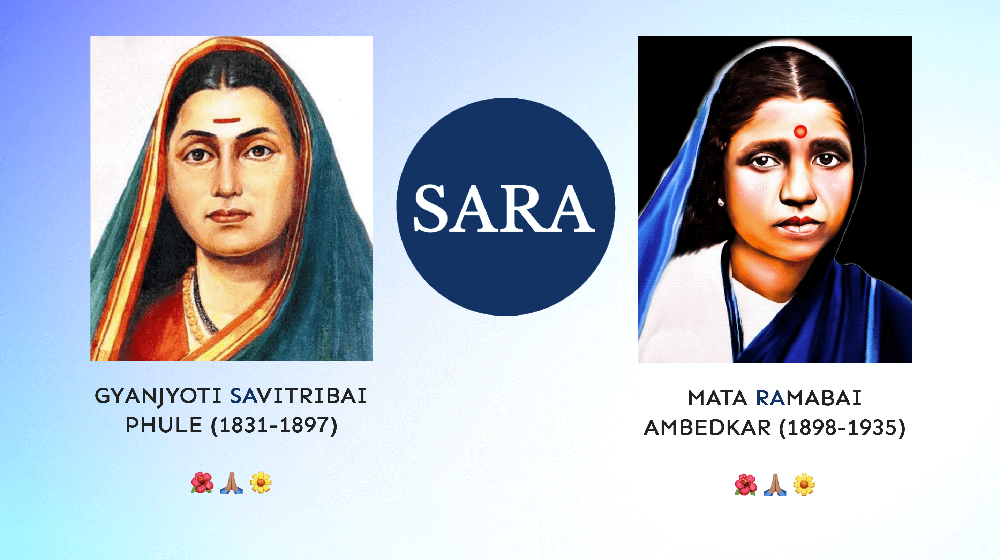{fig-alt="A dedication picture of two legendary women, Mata Savitribai Phule & Mata Ramabai Ambedkar. Sara Institute's name is the combination of the first two letters of their names." }

::: {.centering}

# [Savitribai Ramabai (SARA) Institute of Data Science]{.clr-white}

:::

::::
:::::

::: {.column-page .centering}

# Our Mission 

[We believe data science education belongs to everyone. SARA offers free courses in coding, data analysis, statistics & research - open to all, no matter your background, degree, or income. We all deserve a fair chance to learn.]{.p-mission}

::: {.button}
[Start Learning](summer.qmd)
:::
:::

::: {.centering .column-screen}

```{=html}
<style>
  .sara-carousel { position: relative; max-width: 960px; margin: 2rem auto; }
  .sara-track {
    display: flex; overflow-x: auto; scroll-snap-type: x mandatory;
    scroll-behavior: smooth; border-radius: 12px; scrollbar-width: none;
  }
  .sara-track::-webkit-scrollbar { display: none; }
  .sara-slide { flex: 0 0 100%; scroll-snap-align: center; position: relative; margin: 0; }
  .sara-slide img {
    width: 100%; aspect-ratio: 16 / 9; object-fit: cover;
    object-position: center 30%; display: block;
  }
  .sara-slide figcaption {
    position: absolute; left: 0; right: 0; bottom: 0; padding: 1rem 1.25rem;
    color: #fff; background: linear-gradient(transparent, rgba(0,0,0,.7));
  }
  .sara-btn {
    position: absolute; top: 50%; transform: translateY(-50%);
    width: 42px; height: 42px; border: 0; border-radius: 50%;
    background: rgba(0,0,0,.55); color: #fff; font-size: 1.4rem; cursor: pointer;
  }
  .sara-btn:hover { background: rgba(0,0,0,.8); }
  .sara-prev { left: 10px; } .sara-next { right: 10px; }
  .sara-dots { text-align: center; margin-top: .6rem; }
  .sara-dots button {
    width: 10px; height: 10px; margin: 0 4px; border: 0; border-radius: 50%;
    background: #bbb; cursor: pointer; padding: 0;
  }
  .sara-dots button.active { background: #333; }
  .sara-dots button { position: relative; }
  .sara-dots button::after { content: ""; position: absolute; inset: -10px; }
  @media (max-width: 600px) {
    .sara-carousel { margin: 1rem auto; }
    .sara-track { border-radius: 8px; }
    .sara-slide img { aspect-ratio: 4 / 3; }
    .sara-slide figcaption { padding: .6rem .8rem; font-size: .85rem; line-height: 1.3; }
    .sara-btn { width: 36px; height: 36px; font-size: 1.2rem; }
  }
</style>

<div class="sara-carousel" aria-roledescription="carousel" aria-label="SARA Institute photos">
  <div class="sara-track" id="saraTrack">
    <figure class="sara-slide">
      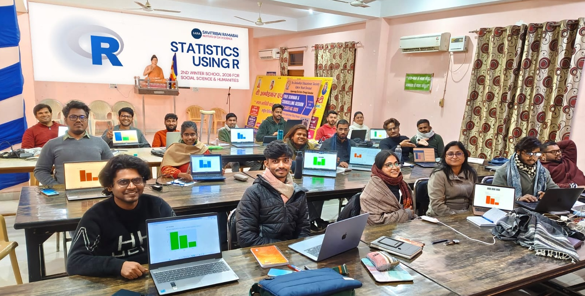
      <figcaption>2nd SARA Winter School: Statistics using R</figcaption>
    </figure>
    <figure class="sara-slide">
      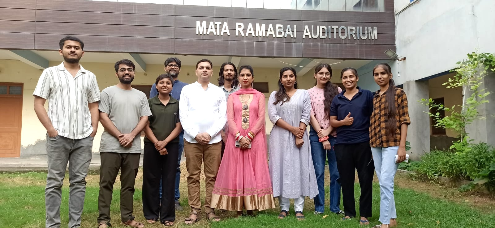
      <figcaption>2nd SARA Summer School: R for Researchers</figcaption>
    </figure>
    <figure class="sara-slide">
      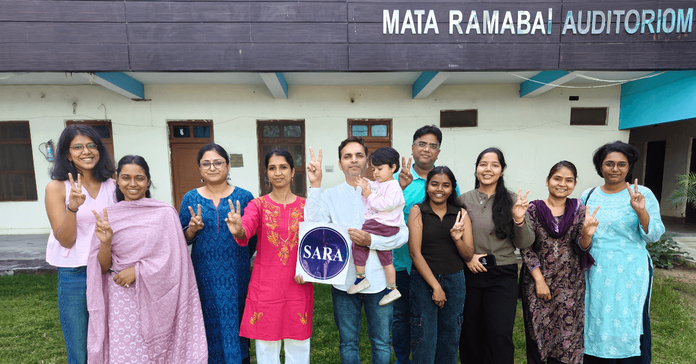
      <figcaption>2nd SARA Coding Bootcamp: Publish using Quarto</figcaption>
    </figure>
    <figure class="sara-slide">
      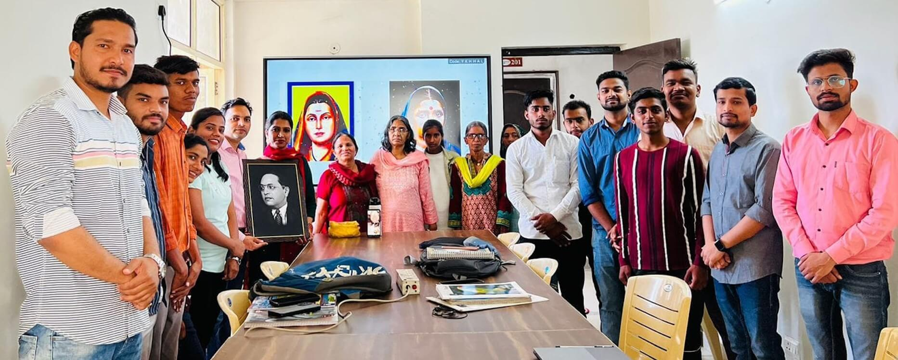
      <figcaption>Our first batch</figcaption>
    </figure>
  </div>
  <button class="sara-btn sara-prev" aria-label="Previous slide">&#8249;</button>
  <button class="sara-btn sara-next" aria-label="Next slide">&#8250;</button>
  <div class="sara-dots" id="saraDots"></div>
</div>

<script>
(function () {
  const track = document.getElementById('saraTrack');
  const slides = track.children, n = slides.length;
  const dotsBox = document.getElementById('saraDots');
  let i = 0, timer;

  for (let k = 0; k < n; k++) {
    const d = document.createElement('button');
    d.setAttribute('aria-label', 'Go to slide ' + (k + 1));
    d.onclick = () => { go(k); restart(); };
    dotsBox.appendChild(d);
  }
  function go(k) {
    i = (k + n) % n;
    track.scrollTo({ left: slides[i].offsetLeft, behavior: 'smooth' });
    [...dotsBox.children].forEach((d, j) => d.classList.toggle('active', j === i));
  }
  function restart() {
    clearInterval(timer);
    if (!matchMedia('(prefers-reduced-motion: reduce)').matches)
      timer = setInterval(() => go(i + 1), 5000);
  }
  document.querySelector('.sara-prev').onclick = () => { go(i - 1); restart(); };
  document.querySelector('.sara-next').onclick = () => { go(i + 1); restart(); };
  track.addEventListener('scroll', () => {
    const k = Math.round(track.scrollLeft / track.clientWidth);
    if (k !== i) { i = k; [...dotsBox.children].forEach((d, j) => d.classList.toggle('active', j === i)); }
  });
  go(0); restart();
})();
</script>
```

:::

<!-- ::: {.column-screen}

{fig-alt="Latest batch of data science students at SARA." fig-align="center"}

::: -->

::::: {.column-page .centering}

```{=html}
<!doctype html>
<html lang="en">
<head>
  <meta charset="utf-8">
  <title>My Page</title>
</head>
<body>
  <h1>Training Partnerships</h1>
</body>
</html>

```


```{=html}
<div class="logo-marquee">
  <div class="logo-marquee-content">
  <!-- First set of logos -->
    <div class="logo-item">
      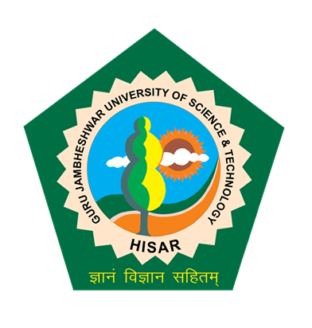
    </div>
    <div class="logo-item">
      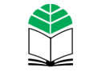
    </div>
    <div class="logo-item">
      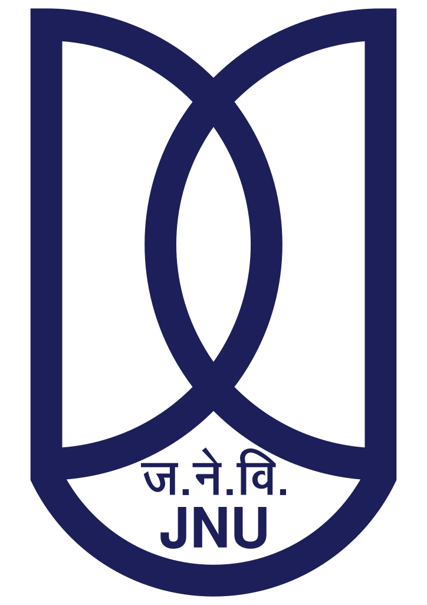
    </div>
    <div class="logo-item">
      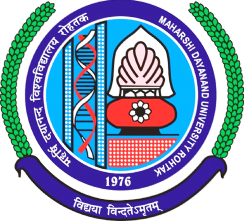
    </div>
    <div class="logo-item">
      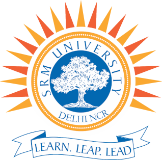
    </div>
    <div class="logo-item">
      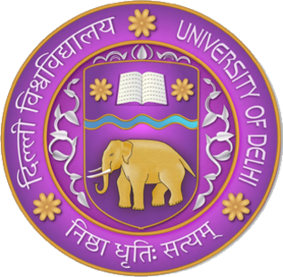
    </div>
  </div>
</div>
```

# Inclusive Education

[Since 2023, we’ve trained 200+ learners from rural communities, public universities, and underrepresented groups across India.]{.p-mission}

<br>

:::: {.layout-grid-course}

::: {.col}
::: {.card}


## Computer Skills

Learn essential computer skills including operating systems, file management, internet navigation, and productivity software—the foundation for digital literacy and data science learning.

[Learn more](offline/computer/index.qmd)

:::
:::

::: {.col}
::: {.card}


## Data Science for Social Impact

Learn R, Python, statistics, and Quarto to conduct rigorous research and analysis

[R](summer.qmd), [Statistics](winter.qmd), [Python](online.qmd), & [Quarto](bootcamp.qmd)

:::

::: {.card}


## Research Methods for Social Science

Scholars can Learn a systematic approach to investigate, analyse, and interpreting information quantitative and qualitative.

[Learn more](summer.qmd)
:::
:::


::: {.col}
::: {.card}


## English Language

Learning English enhanced global communication, opens doors to diverse cultures, facilitates travel, and provides a competitive edge in the global job market.

[Learn more](offline/english/index.qmd)

:::
:::

::::

<br>

:::::

::: {.column-screen}

{fig-alt="First batch data science students at SARA."}
:::

::::: {.column-screen .banner-cream .centering}

# Data Science Trainings

[Week-long Offline Trainings of Data Science.]{.p-mission}

:::: {.feedback-layout-grid }

::: {.col}
:::

::: {.col}
::: {.card}

## 2nd SARA Summer School <br> "R for Researchers" <br> 25-29 July 2025 {.centering}

{width="90%"}

> *I got more hand-on experience during the workshop. Most importantly lost my fear of R.*      
> --- **Hardik Parmar, MA, TISS-Mumbai**

> *Interactive teaching is what I consider as the main features. I recommend course to others.*    
> --- **Jatin Mathur, MA Soc., DSE-DU**

> *This summer school has given me the confidence that I can become better with R*         
> --- **R. Tharun, MA, TISS-Mumbai**

> *I'm from Humanities background & data, programming, & coding seem bit difficult. But SARA made this so comfortable.*              
> --- **Komal Devi, PhD Scholar, Pol. Sci. JNU**

> *Hands-on training was greatly impactful.*          
> --- **Dr. Madhu Bala, PhD in Soc., JNU**

> *Its really commendable the way faculty explains each and every step in his classes.*          
> --- **Md. Allam Ashraf, PhD Scholar, Soc., Jamia University**

[Know more](summer/2025-r4b/index.qmd)

:::
:::

::: {.col}
::: {.card}

## 2nd SARA Winter School <br> "Statistics using R" <br> 23-27 Jan 2026 {.centering}


> *The progressive structuring of the course made the complex statistics concepts accessible & understandable.*      
> --- **Dr. Priyanka Choudhary, Asst. Prof. Pol. Sci., Delhi University**

> *My most of doubts are cleared & it will enhance the quality of my PhD thesis.*      
> --- **M. Shiva Kumar, PhD Spanish, JNU**

> *Sessions were very helpful & guided my PhD research in the right direction.*         
> --- **Keerthivasan, PhD Media & Journalism, Woxsen University**

> *The step by step approach by the instructors made the sessions accessible for participants from non-technical background.*      
> --- **Dr. Mridula Manglam, PhD Pol. Sci., Allahabad University**

> *It has endowed me with confidence to learn R & Stats myself.*     
> --- **Mohit Jorwal, PhD Pol. Sci., JNU**

> *A respectful environment, people are helpful with humility. Never felt excluded or anxious of doing wrong/mistakes.*         
> --- **Dr. Dhiraj Singh, PhD Sociology, Ambedkar University**

[Know more](winter/2025-stats-winter/index.qmd)

:::
:::

::: {.col}
::: {.card}

## 2nd SARA Coding Bootcamp <br> "Publish using Quarto" <br> 20-22 March 2026 {.centering}


> *so much effort in slides and teaching hand-on ... teaching meticulously and not charging anything requires a lot of patience and expertise*      
> --- **Jigeesha Bhargavi, MA Pol. Sci., Delhi**

> *receptive in this approach, ever so ready to clarify our doubts and give insightful updates*          
> --- **Chetna Rani, MA Pol. Sci., JNU**

> *the hand-on practice which is rare has added to the confidence taht even I can build website*       
> --- **Name not shared**

> *Thank you for providing minority students this opportunity for uplifting*        
> --- **Name not shared**

>  *now I have little more confidence that I have basic knowledge about data science and I'll learn more*        
> --- **Name not shared**

[Know more](bootcamp/2025-bootcamp/index.qmd)

::: 
::: 

::::

<br>

----

<br>

:::::

:::: {.column-screen .banner-white}

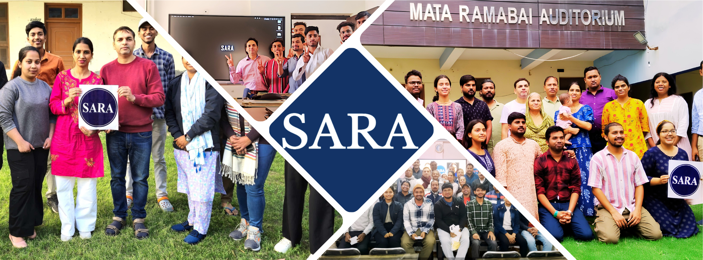

::::

:::: {.column-page .banner-white .centering}

# Support SARA

[Your contribution breaks barriers and opens doors to data science careers for marginalized communities and women.]{.p-mission}

::: {.button}
 []{style="color:red"} &nbsp; [Donate Now](donate.qmd)
:::

::::


::: {.column-screen .banner-cream .centering}

# Thank You!

[An inclusive organization is built with community.]{.p-mission}

[Thank you for being a part of SARA!]{.p-mission}

<br>

::: {.flex-container}

::: {.layout-grid-img}

::: {.col}

:::

::: {.col}

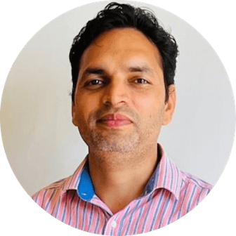{width=65%}<br>Dr. Ajay Koli, PhD | [](https://www.linkedin.com/in/ajay-kumar-koli/)<br>Founder & Director, SARA Institute<br>[koliajaykumar\@gmail.com](mailto:%20koliajaykumar@gmail.com)

:::

::: {.col}

:::


::: {.col}
:::

:::
:::


<br>

[With your support, we build SARA for a brighter future.]{.p-mission}


[Home](index.qmd) &nbsp; [About](about.qmd) &nbsp; [Data Schools](summer.qmd) &nbsp; [Online Classes](online.qmd) &nbsp; [News](news.qmd) &nbsp; [Donate](donate.qmd) &nbsp; [Contact](contact.qmd)

:::
