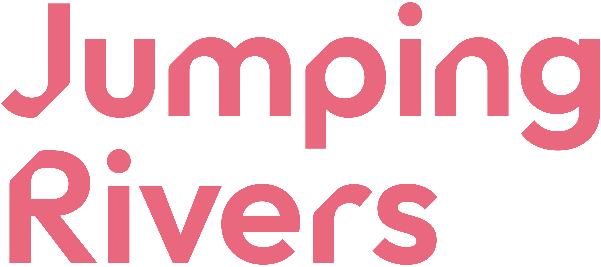
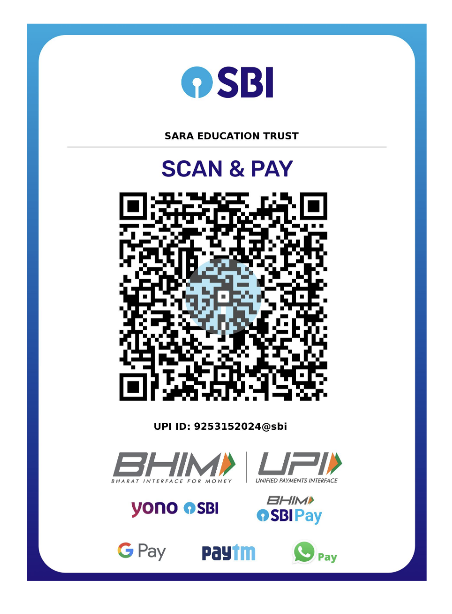
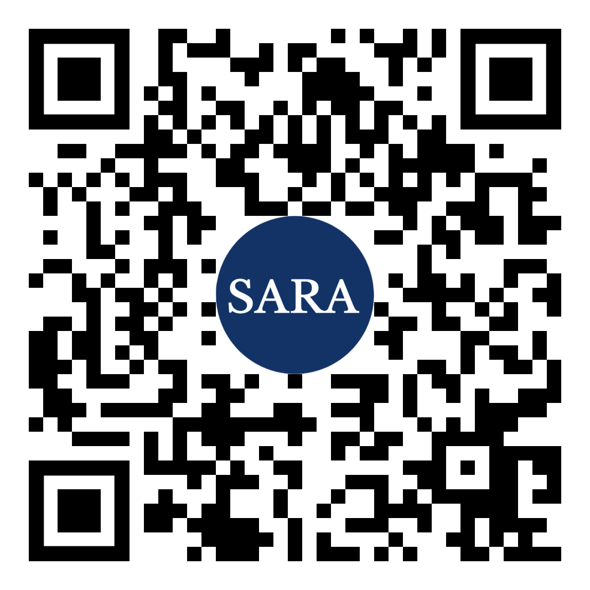

```{=html}
<style>
/* Small, self-contained styles; no external CSS or JavaScript required. */


.winter-btn { display: inline-block; padding: .7rem 1rem; border-radius: .45rem; text-decoration: none; font-weight: 650; border: 1px solid #003262; }
.winter-btn-primary { background: #003262; color: #fff !important; }
.winter-btn-outline { color: #003262 !important; background: transparent; }
.winter-panel { border: 1px solid var(--bs-border-color); border-radius: .7rem; padding: 1rem 1.1rem; height: 100%; }
.winter-panel h3 { margin-top: 0; font-size: 1.08rem; }
.winter-note { border-left: 4px solid #b08a36; padding: .75rem 1rem; background: var(--bs-tertiary-bg); border-radius: 0 .45rem .45rem 0; }
.winter-flyer { width: 100%; max-width: 850px; display: block; margin: 0 auto; border: 1px solid var(--bs-border-color); border-radius: .5rem; }
.winter-muted { color: var(--bs-secondary-color); font-size: .94rem; }
.winter-speaker-photo { width: 100%; aspect-ratio: 4 / 3; object-fit: cover; border-radius: .45rem; background: var(--bs-tertiary-bg); }
@media (max-width: 600px) {
  .winter-hero { padding-top: 1rem; }
  .winter-btn { width: 100%; text-align: center; }
}
</style>
```

<br>

A five-day, offline, hands-on, in-person course for Social Science and Humanities learners. No previous coding experience is needed.

👥 Only 20 seats     
📅 25-29 December 2026   
🍲 Food and stay included     
📍 Dr. Ambedkar Bhawan, Sonipat, Haryana


<div class="winter-actions">
  <a class="winter-btn winter-btn-primary" href="#registration">Registration & payment</a>
  <a class="winter-btn winter-btn-outline" href="#fees">Fees and scholarships</a>
  <a class="winter-btn winter-btn-outline" href="#flyer">View flyer</a>
</div>

<br>

### Thank you to our sponsor

<!-- Replace with the JR image -->


Know more about [Jumping Rivers](https://www.jumpingrivers.com/)

<br>

## Programme

| Date | Focus |
|---|---|
| **24 December (Thursday)** | Arrival and check-in in the evening |
| **25 December (Friday)** | Getting started: R/RStudio, data types, importing data and tidy data |
| **26 December (Saturday)** | Describing data: summary statistics, tables, distributions and `ggplot2` |
| **27 December (Sunday)** | From sample to population: sampling, probability and confidence intervals |
| **28 December (Monday)** | Testing ideas: hypothesis tests, *t*-test, chi-square and ANOVA |
| **29 December (Tuesday)** | Relationships and reporting: correlation, regression and sharing results; closing ceremony around 9 PM |
| **30 December (Wednesday)** | Departure |

A typical learning day runs from **10:00 AM to 6:00 PM**, with hands-on practice, lunch and question breaks. Timings may be adjusted and confirmed with registered participants.

## Who should apply?

- Master’s, MPhil and PhD students in Social Science and Humanities
- Researchers and teachers who want practical data-analysis skills
- NGO and policy professionals working with survey data
- First-generation learners (five fully free seats)

## Instructor


### Dr. Ajay Kumar Koli

*Founder and Director, SARA Institute of Data Science*

Dr. Ajay Kumar Koli will teach all modules across the five days, building concepts progressively from one day to the next.

- **Areas:** Research methods, data analytics and R
- **Experience:** 10 years of teaching and research
- **Training:** 20+ research and data-science trainings

### International online guest speakers

International experts will join online for special talks. Speaker names, affiliations, talk titles and session timings will be announced soon.

## Fees, seats & scholarships {#fees}

| Category | Seats | Fee | Deadline / details |
|-------|:---:|:---:|---------|
| Fully free seats | 5 | ₹0 | For first-generation learners; apply by **22 November 2026** |
| Early bird | 7 | ₹3,600 | 40% discount until **27 November 2026**, or until seats are filled |
| Regular | 8 | ₹6,000 | From **28 November 2026**; registration closes **18 December 2026** |
| Supporter | — | ₹8,000+ | Optional additional contribution helps support a free seat |

The fee includes **food, accommodation, learning materials and a certificate**. A certificate is provided to participants who attend all five days.


::: {.callout-important title="Key Dates"}

Free-seat applications close 22 November · free-seat results 25 November · early bird ends 27 November · full-refund deadline 4 December · registration closes 18 December.

:::

## Venue & practical information

**Dr. Ambedkar Bhawan, Sonipat**  
The Ambedkar Educational Society, near Dayanand Hospital, Kakroi Road, Sonipat, Haryana 131001.

- From Sonipat railway station or bus stand, an e-rickshaw takes approximately 10 minutes.
- Bring a laptop and charger, one recent passport-size photograph, ID proof and warm clothes.
- A blanket is provided; bring an extra one if you feel cold.
- Participants should use their own internet connection during the stay.
- Food is vegetarian. Alcohol, smoking and tobacco are not allowed in the premises.
- Accommodation is simple, hostel-style shared dorms and washrooms, separate for men and women.
- Please contact SARA before registering if you have accessibility requirements or health needs to discuss.

**Arrival contact:** Mr. Raj Pal - 93063 42596 or 99917 73740  
**Questions from women:** Dr. Kiran Lata - 81680 60500

## Free seat application

Five seats are free for first-generation learners. To apply, email `sara.institute.info@gmail.com` by **22 November** with the subject line “Free seat: [your name]”. We will announce the selected learners on **25 November.**

#### In your email, please tell us:

- who you are, where you study or work, and your city
- why you need a free seat, and what you hope to do with R after the Winter School
- that you will reach the venue on **24 December** and attend all five days

#### Please note

- You must be a first-generation learner.
- You must not be receiving any other fellowship at the time of applying.
- Write in your own words, in 150 to 250 words. Emails written by AI, copied from others or sent as mass messages will be rejected.
- Send one email only. No documents are needed.
- A video call may be required before a free seat is confirmed.
- Priority goes to learners from marginalized communities and women.

**Contact:** `925 315 2024` · `sara.institute.info@gmail.com`

## Registration & payment {#registration}

Follow these three steps to register for the Winter School.

### 1. Make payment

Scan the payment QR code using any UPI app.

<!-- Replace with the actual payment QR image -->


**You can also use SARA Bank details**

- Account name: SARA EDUCATION TRUST
- Bank: State Bank of India, Sonipat
- Account number: `42920911856`
- IFSC: `SBIN0000721`
- UPI ID: `9253152024@sbi`

Keep a screenshot of your successful payment.

### 2. Registration guidelines

1. Select the appropriate fee category.
1. For paid categories, complete the payment before filling in the form.
1. Free seat: upload a screenshot of your SARA confirmation email.
1. Enter your UTR or transaction reference number accurately.
1. Keep your payment screenshot until your registration is confirmed.
1. Read the photo-consent question and indicate your preference.
1. Submit the form and wait for confirmation by email.


::: {.callout-important}

**Paid seats:** A paid seat is confirmed only after SARA verifies the payment. Submitting the form alone does not confirm your seat.

**Free seats:** Five fully free seats are available for first-generation learners. Apply by 22 November 2026. No supporting documents are required, according to the brochure.

:::

### 3. Complete Registration

<!-- Replace with the actual registration QR image -->


Scan this QR code to open the registration form or click on this link [https://forms.gle/EEne7qCCUX7LstpN6](https://forms.gle/EEne7qCCUX7LstpN6)

## Flyer and detailed brochure {#flyer}

Share it today. Help someone learn tomorrow. Together, let’s make education accessible to everyone!

<div class="winter-actions">
  <a class="winter-btn winter-btn-primary" href="winter-school-flyer.pdf" download>Download flyer (PDF)</a>
  <a class="winter-btn winter-btn-outline" href="winter-school-brochure.pdf" download>Download detailed brochure (PDF)</a>
</div>

### Flyer preview

<!-- Replace docs/3rd-sara-winter-school-2026-flyer.pdf with the final flyer PDF path. -->
<object data="winter-school-flyer.pdf#toolbar=0&navpanes=0" type="application/pdf" width="100%" height="620" aria-label="Preview of the 3rd SARA Winter School 2026 flyer">
  <p>Your browser cannot display the PDF preview. <a href="3rd-sara-winter-school-2026-flyer.pdf">Open or download the flyer</a>.</p>
</object>

<p class="winter-muted">If the PDF preview does not load on your device, use the Download flyer button above.</p>
